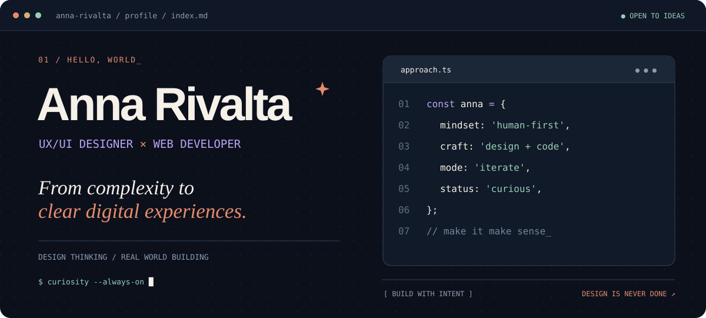

<div align="center">



<br>

[](https://www.linkedin.com/in/anna-rivalta/)
[](mailto:anna.rivalta@dma.it)

<sub>📍 Forlì, Italy · Digital experiences, from idea to implementation</sub>

</div>

<br>

### `01 / about_me`

I’m **Anna**, a **UX/UI designer and web developer** who loves the space between thoughtful design and practical implementation.

I work across **UX/UI, websites, content and digital communication**. I enjoy taking something complex, finding the thread that makes it understandable, and shaping an experience that’s clear, useful and enjoyable to use.

For me, good design doesn't stop at the mockup. **It has to work in the real world**: in the browser, in the content, in the details and in the changes we make after launch.

```js
const anna = {
  approach: ["understand", "design", "build", "improve"],
  intersection: "human needs × visual design × technology",
  currently: "building stronger digital experiences",
  sideQuests: ["anime", "board games", "creative experiments"]
};
```

### `02 / how_i_think`

> **UNDERSTAND → DESIGN ↔ BUILD ↔ IMPROVE**
>
> Understand the problem. Design for people. Build with intention. Improve through feedback.

My process isn’t a one-way checklist: design, development and improvement continuously inform one another.

### `03 / the_toolkit`

**Design & experience**


**Build & CMS**


**Optimize & communicate**


<sub>My toolkit spans design, implementation and content. The badges are tools and areas I work with, not proficiency rankings.</sub>

### `04 / selected_work`

<table>
<tr>
<td width="50%" valign="top">

#### 🌱 Studio Il Soffio

**Website · WordPress · Elementor**

Structuring a professional-services website around people, services and clear navigation, with attention to content and discoverability.

<sub>Real project · detailed case study in preparation</sub>

</td>
<td width="50%" valign="top">

#### 🧩 B2B digital experiences

**Digital communication · UX · Web**

Working at the intersection of business goals, content and digital touchpoints: connecting what organizations need with experiences that make sense to users.

<sub>Professional experience · selected details not publicly documented</sub>

</td>
</tr>
</table>

> 🚧 **Portfolio under construction.** I’m preparing case studies that explain the problems, decisions, implementation and lessons learned - not just the final screens.

### `05 / github_activity`

<div align="center">

[](https://github.com/annarivalta)

</div>

<sub>Most design work doesn't show up as GitHub commits. Code is one part of the picture, not the whole story.</sub>

### `06 / side_quests`

```text
🎮  board games      → systems, strategy & playful thinking
🌸  anime            → stories, worlds & a little obsession
✨  creative making  → always experimenting with something new
```

---

<div align="center">

**Designing with empathy. Building with curiosity.**

<sub>Thanks for visiting my little corner of the internet. 💜</sub>

</div>

