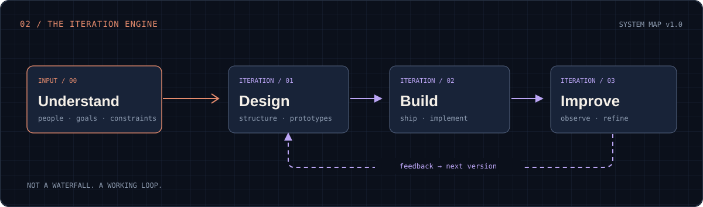

<div align="center">


<br/>

[](https://www.linkedin.com/in/anna-rivalta/)
[](mailto:anna.rivalta@dma.it)

<sub>📍 Forlì-Cesena, Italy · Human-centered design meets practical development</sub>

<br/><br/>


</div>

---

### `01 / whoami`

Hi, I'm **Anna** 👋 - a **UX/UI Designer & Web Developer** working where **design, technology and digital communication** meet.

I turn complex needs into digital experiences that are **clear, useful and thoughtfully built**. I care about understanding people, organizing information, designing interfaces, implementing websites and improving what happens after launch.

My background also includes **digital marketing, B2B projects, content strategy, SEO and HubSpot**. To me, good design is not simply how a screen looks: it is how the whole experience works.

```js
const anna = {
  role: ['UX/UI Design', 'Web Development', 'Digital Experience'],
  approach: 'understand → design ↔ build ↔ improve',
  mindset: ['curiosity', 'clarity', 'human-centered thinking'],
  sideQuests: ['anime', 'board games', 'creative making'],
  portfolio: 'work in progress'
};
```

### `02 / the_way_i_work`

<div align="center">
  
</div>

**I don't believe in design that stops at the handoff.** Research informs decisions; implementation tests them; real feedback shapes the next iteration.

### `03 / creative_stack`

<table>
<tr>
<td valign="top" width="50%">

**🎨 Design & UX**


</td><td valign="top" width="50%">

**💻 Web & CMS**


</td>
</tr><tr><td valign="top" width="50%">

**🧩 Digital experience & marketing**


</td><td valign="top" width="50%">

**🔍 Improve & optimize**


</td></tr>
</table>

<sub>These are tools and areas of practice, not proficiency ratings or certifications.</sub>

### `04 / selected_work`

<table>
<tr><td valign="top" width="50%">

#### 🌿 Studio Il Soffio

**Professional-services website** · WordPress · Elementor · Content structure

A website designed to make services, professionals and useful information easier to discover and navigate. Work spanning information structure, implementation and content refinement.

<sub>Real project · full case study being prepared</sub>

</td><td valign="top" width="50%">

#### 🧩 B2B digital experiences

**Web · UX · HubSpot · Digital communication**

Experience working across business objectives, content and digital touchpoints, balancing usability, implementation and communication needs.

<sub>Professional work · selected details not publicly shared</sub>

</td></tr>
</table>

<details>
<summary><b>✨ What makes a project worth sharing?</b></summary>
<br/>

Not just the polished final screen. I want to show the **problem**, the **constraints**, the **decisions**, what was **actually built**, and what I **learned or improved** along the way.

My portfolio and full case studies are currently in preparation.

</details>

### `05 / github_activity`

<div align="center">

<a href="https://github.com/annarivalta">
  
</a>
<a href="https://github.com/annarivalta?tab=repositories">
  
</a>

</div>

<sub>GitHub activity captures only part of my work. Research, UX, content, CMS work and client projects aren't always represented in public commits. Third-party statistic images may occasionally be unavailable.</sub>

### `06 / side_quests`

<details>
<summary><b>👾 Open the nerd corner</b></summary>
<br/>

```txt
> anna --side-quests

[██████████] anime & storytelling
[██████████] board games & playful systems
[████████░░] creative experiments
[██████████] making things just because

achievement unlocked: curiosity never expires ✨
```

Design systems by day, fictional worlds and board games whenever possible.

</details>

---

<div align="center">

**Designing with empathy. Building with curiosity. Improving with purpose.**

<sub>Thanks for visiting this little corner of the internet. 💜</sub>

</div>
