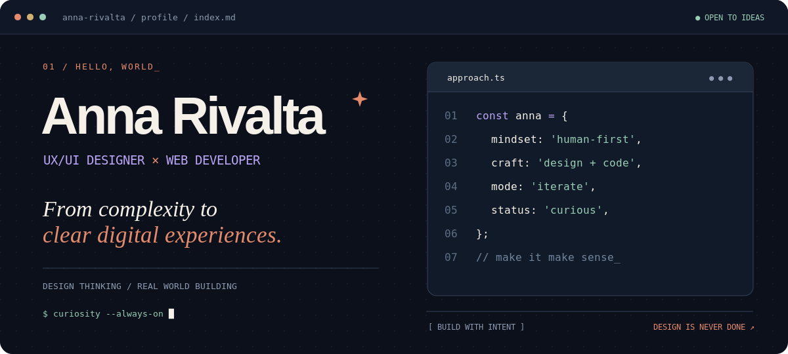
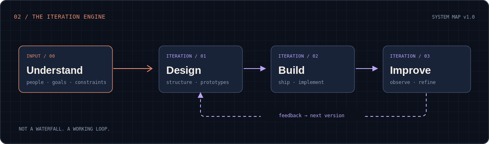

<div align="center">



<br />

**I turn complex needs into useful digital experiences, from the first question to the working interface.**

[**PORTFOLIO ↗**](https://anna-rivalta-portfolio.lorileo12.chatgpt.site/) &nbsp; · &nbsp; [**LINKEDIN ↗**](https://www.linkedin.com/in/anna-rivalta/) &nbsp; · &nbsp; [**EMAIL ↗**](mailto:anna.rivalta@gmail.com)

</div>

---

### `01 / whoami`

Hey, I'm **Anna**. I work across **UX/UI design, web development and digital communication**, connecting the messy early questions to interfaces people can actually use.

I like understanding the *why* before getting lost in the *how*. Then I design, implement, test assumptions and iterate. The goal isn't another polished screen. It's **less friction, more clarity**.

```ts
const anna = {
  role: ['UX/UI designer', 'web developer'],
  from: 'Forlì-Cesena, Italy',
  approach: ['understand', 'design', 'build', 'improve'],
  values: ['clarity', 'empathy', 'craft', 'curiosity'],
  favoriteFeature: 'making complicated things feel simple',
} as const;
```

### `02 / thinking in loops`



I don't see design as a one-way handoff. **Research guides the first iteration; building and observing inform the next.** Constraints aren't an afterthought. They're part of designing well.

### `03 / toolkit, not trophies`

| Make sense of it | Make it work |
| :-- | :-- |
| **UX & product thinking**<br>Information architecture · Wireframes · Prototyping · Figma | **Web & implementation**<br>HTML · CSS · WordPress · Elementor · CMS |
| **Connect the dots**<br>Content structure · SEO · Digital communication · HubSpot | **Learn & improve**<br>UX analysis · Microsoft Clarity · Hotjar · Iteration |

<sub>Actual areas I work with, not invented proficiency percentages.</sub>

### `04 / built in the real world`

**Studio Il Soffio**  
Professional-services website · WordPress / Elementor / information architecture. Work across content structure, navigation and implementation.

**B2B digital experiences**  
Business-facing digital projects connecting user needs, communication, CMS work and web delivery. Some client and technical work stays private.

No fake pinned projects. No inflated public code metrics. **The work is real even when the repository isn't public.**

### `05 / easter eggs`

<details>
<summary><b>▸ Run side_quests.sh</b></summary>

<br />

```shell
$ ./side_quests.sh

[✓] exploring anime worlds
[✓] reverse-engineering board game rules
[✓] making things with my hands
[✓] getting curious about another idea

exit code: 0  # fun is a feature
```

</details>

<details>
  <summary>🐍 View contribution snake</summary>

  <br>

  <div align="center">
    
  </div>
</details>


---

<div align="center">

`DESIGN WITH EMPATHY` · `BUILD WITH CURIOSITY` · `IMPROVE WITH PURPOSE`

<sub>Thanks for stopping by this corner of the internet. ✳</sub>

</div>
